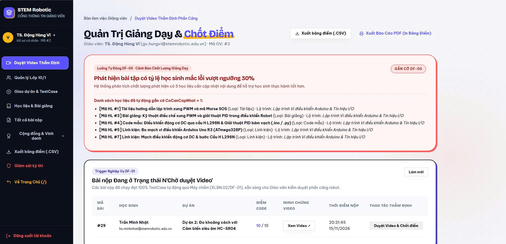
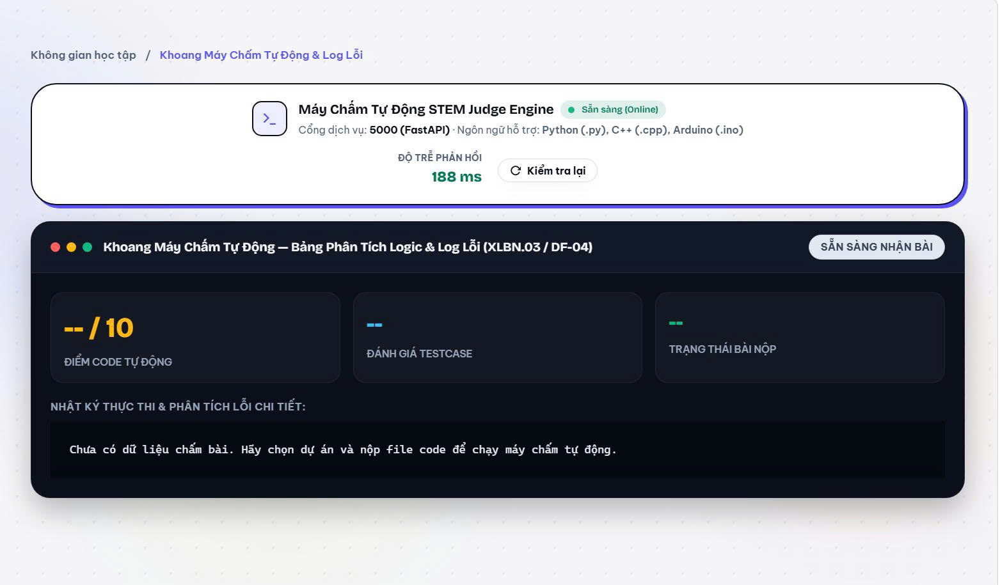
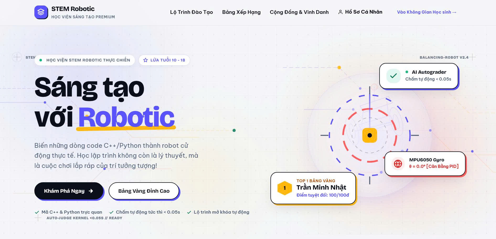
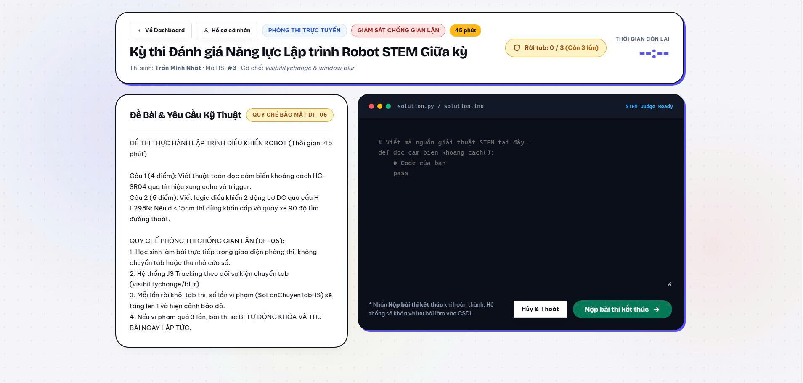

# 📝 NHẬT KÝ PHÁT TRIỂN & LỊCH SỬ NÂNG CẤP HỆ THỐNG (CHANGELOG)

Dự án: **Hệ thống Học tập & Quản lý Đào tạo STEM Robotic Cấp Trung Học**  
Đơn vị: **Đại học Đà Nẵng — Trường Đại học Sư phạm — Khoa Toán - Tin**  
Giảng viên hướng dẫn: **TS. Đặng Hùng Vĩ**  
Nhóm sinh viên thực hiện: **Nhóm A+ (24SPT)**  
- Phạm Kỳ Hải (23SPT)
- Trần Minh Nhật (23SPT)
- Phạm Thị Hà Vy (24SPT)
- Trần Thế Quân (24CNTT1)
- Nguyễn Thị Thanh Thảo (24CNTT1)

---

## 🗺️ TỔNG QUAN TIẾN ĐỘ 5 CHẶNG PHÁT TRIỂN NỘI BỘ (01/11/2026 – 15/11/2026)

Hệ thống được phát triển tuần tự và khép kín qua 5 chặng phát triển đồng bộ giữa 5 thành viên nhóm A+, phủ kín toàn bộ 27/27 mô đun IPO và 7 luồng tự động DF-01 đến DF-07:

| Chặng | Mốc Thời Gian | Mục Tiêu & Trọng Tâm Kỹ Thuật | Sản Phẩm Hoàn Thành & Kết Quả | Phụ Trách Chính |
|:---:|:---:|:---|:---|:---|
| **Chặng 1** | 01/11 – 03/11 | Khảo sát thực tế, đặc tả 27 IPO (`PRODUCT.md`), thiết kế CSDL SQL Server 12 bảng BCNF (`database_schema.sql`), khởi tạo UI Neo-Brutalist (`theme.css`) | Hoàn thiện tài liệu Single Source of Truth, CSDL BCNF, Design System không AI-Slop, kế hoạch kiểm thử QA | Toàn nhóm (Quân, Vy, Thảo, Hải, Nhật) |
| **Chặng 2** | 04/11 – 06/11 | Xây dựng Web Server Node.js (Port 80), xác thực SSO, phân quyền RBAC 4 vai trò (`authMiddleware.js`), nạp 3 lộ trình học và 8 bài học liệu nền tảng | Đăng nhập/Đăng ký an toàn, 3 lộ trình & 8 học liệu, Bảng vinh danh, 12 Test Cases thuật toán | Nhật, Quân, Vy, Thảo, Hải |
| **Chặng 3** | 07/11 – 09/11 | Xây dựng Judge Engine FastAPI (Port 5000), Sandbox cô lập 3.0s, mock phần cứng `arduino_mock.h`, nghiệm thu kép mã nguồn + Video, mở khóa tuần tự | Hoàn thiện máy chấm C++/Arduino/.py, thẩm định video DF-01, mở khóa DF-02, tra cứu linh kiện TCPP.02 | Nhật, Quân, Vy |
| **Chặng 4** | 10/11 – 12/11 | Phòng thi chống gian lận chuyển tab (`DF-06`), quét lỗi bài nộp >30% cảnh báo học liệu (`DF-05`), xuất báo cáo CSV/PDF, hỗ trợ sự cố, diễn đàn kỹ thuật (`DF-03`), khóa mềm (`DF-07`) | 27/27 IPO hoàn thiện, 7/7 luồng tự động kích hoạt, xuất bảng điểm CSV/PDF, phòng thi trực tuyến an toàn | Hải, Thảo, Vy, Quân |
| **Chặng 5** | 13/11 – 15/11 | Kiểm thử tích hợp E2E (`full_system_test.js` 37/37 PASS), công cụ khởi động 1-Click Watchdog dọn cổng (`STEM_Robotic_App.ps1`), đóng gói Release GitHub | 37/37 Test PASS (100%), 1-Click .bat, fix UI giáo viên (v2.2.0), đồng bộ tài liệu tiến độ nhóm | Nhật, Hải & Cả nhóm |

> 📑 *Chi tiết phân công nhiệm vụ từng thành viên, sản phẩm Pull Request và nhật ký từng chặng xem tại [docs/BAO_CAO_TIEN_DO_NHOM.md](docs/BAO_CAO_TIEN_DO_NHOM.md).*

---

## 🌟 [v2.4.0] - 24/11/2026 — CHUẨN HÓA MỞ KHÓA DF-02, BẢO MẬT BCRYPT & BỘ KIỂM THỬ UNIT TEST 23SPT

Phiên bản tập trung vá lỗ hổng bảo mật toàn hệ thống, chuẩn hóa điều kiện mở khóa lộ trình tự động DF-02 & QLDA.02, nâng cấp giao diện Anti-AI-Slop và bổ sung bộ kiểm thử đơn vị Unit Test đạt chuẩn 100% PASS.

### 1. Chuẩn Hóa Nghiệp Vụ Mở Khóa Thử Thách & Lộ Trình (DF-02, QLDA.02)
- **Tích hợp cải tiến hiển thị điểm số linh hoạt:** Trích xuất `ISNULL(kq.TongDiem, kq.DiemCode)` trên `GET /projects` và `GET /lotrinh`, giúp học sinh theo dõi kết quả máy chấm ngay khi vừa vượt qua bài thi Code mà không cần chờ giáo viên chốt điểm thủ công.
- **Vá triệt để lỗ hổng điều kiện SQL mở khóa bài:**
  - Loại bỏ hoàn toàn điều kiện lỏng lẻo khiến bài 0 điểm bị chốt điểm vẫn được mở khóa bài tiếp theo.
  - Phân định rõ 2 trường hợp hợp lệ: (1) Bài đã chốt điểm đạt $\ge 5.0$ hoặc Video đạt; (2) Bài đang ở trạng thái `Chờ duyệt Video` nhưng máy chấm tự động xác nhận mã nguồn đã đạt 100% Test Case (`KetQuaCode = 'Đạt'` hoặc `DiemCode >= 5.0`).
- **Đồng bộ toàn diện 4 điểm chạm API:** Chuẩn hóa logic kiểm tra tiên quyết đồng thời trên `GET /projects`, `GET /projects/:id`, `GET /lotrinh` và `POST /submissions` (ngăn ngừa chặn nhầm HTTP 403 khi nộp bài).

### 2. Tăng Cường Bảo Mật Toàn Diện (Security Hardening)
- **Mã hóa mật khẩu chuẩn Bcrypt (`bcryptjs`):**
  - Chuyển đổi toàn bộ cơ chế lưu trữ mật khẩu plaintext sang mã hóa salt-hash Bcrypt độ phức tạp 10 rounds cho Đăng ký (`POST /api/auth/register`), Đặt lại mật khẩu OTP (`POST /api/auth/reset-password`) và Đổi mật khẩu cá nhân (`POST /api/auth/profile`).
  - **Cơ chế Tự Động Nâng Cấp (Auto-upgrade on Login):** Người dùng có mật khẩu plaintext từ seed data ban đầu tự động được nâng cấp lên Bcrypt hash trong CSDL ngay sau lần đăng nhập đầu tiên thành công.
- **Khóa cơ chế Giả lập Header trên Môi trường Thực tế (RBAC Hardening):**
  - Giới hạn chế độ Header Emulation (`x-admin-role`, `x-role`, `x-user-id`) chỉ được phép hoạt động trong môi trường phát triển & kiểm thử tự động (`NODE_ENV !== 'production'`).
  - Luôn ưu tiên Session máy chủ thực tế trước tiên, triệt tiêu nguy cơ chiếm đoạt quyền Admin qua cURL/Postman.
- **Thiết lập Cookie Phiên an toàn (Session Security):** Kích hoạt đầy đủ các thuộc tính `httpOnly: true`, `sameSite: 'lax'` và cờ `secure` trên môi trường Production HTTPS.

### 3. Chuẩn Hóa Giao Diện & Quy Chuẩn Anti-AI-Slop (UI/UX)
- **Tách bạch trạng thái tiến độ:** Phân định rõ ràng huy hiệu thẻ nhiệm vụ (Mission Card):
  - `Hoàn thành (X/10)` (Xanh ngọc bích `--c-success`) cho bài đã được giáo viên duyệt.
  - `Chờ duyệt Video (X/10)` (Vàng hổ phách `--c-accent`) cho bài đã vượt qua máy chấm tự động.
- **Tuân thủ quy chuẩn Anti-AI-Slop:** Loại bỏ toàn bộ emoji (`✓`, `⏳`) trong nhãn trạng thái và nút bấm, đảm bảo 100% giao diện thuần SVG vector sắc nét theo chuẩn Creative Studio & Neo-Brutalist.

### 4. Bổ Sung Bộ Kiểm Thử Đơn Vị (Unit Test) & Tài Liệu Nghiệm Thu
- **Module đánh giá mã nguồn `codeSubmissionEvaluator.js`:** Thực hiện tính toán điểm tổng, xác định ngưỡng đạt 8.0/10, xử lý làm tròn 2 chữ số thập phân, kiểm soát vi phạm thời gian Timeout (3000ms) và ném ngoại lệ dữ liệu đầu vào.
- **Bộ 10 Unit Tests (`tests/codeSubmissionEvaluator.test.js`):** Đạt tỷ lệ thành công 10/10 PASS (100%).
- **Tài liệu báo cáo:** Bổ sung báo cáo nghiệm thu kiểm thử `Bao_Cao_Unit_Test_STEM_Robotic_Nhom_23SPT.docx`.

---

## 🌟 [v2.3.0] - 15/11/2026 — ĐỒNG BỘ CODE MẪU 10/10Đ, CHUẨN HÓA LỚP 10/1, THẢO LUẬN REALTIME & NÂNG CẤP GIAO DIỆN

Phiên bản hoàn thiện toàn diện chất lượng đào tạo, tối ưu hóa thuật toán chấm điểm tự động, chuẩn hóa dữ liệu học sinh lớp 10/1 và nâng cấp tính năng tương tác cộng đồng theo phản hồi thực tế từ người dùng.

### 1. Đồng Bộ Mã Nguồn Mẫu 100% Điểm, Chuẩn Hóa Judge Engine & Xử Lý Bài Nộp (XLBN.01 – XLBN.03, DF-01, DF-04)
- **Tích hợp nút "Tải code mẫu 100%" đạt chuẩn 10/10 điểm cho toàn bộ 5 dự án:**
  - Cung cấp sẵn giải pháp chuẩn sư phạm (`passedAll: true`, đạt tối đa 10.0/10 điểm) cho tất cả các dự án trong hệ thống (`.py`, `.cpp`, `.ino`).
  - *Dự án 1 (Blink SOS):* Thuật toán xử lý chuỗi và phát xung Morse SOS.
  - *Dự án 2 (Siêu âm HC-SR04):* Đo khoảng cách theo công thức phản hồi vi giây ($d = t / 58.0$).
  - *Dự án 3 (Cầu H L298N & Xe né vật cản):* Giải thuật điều hướng chuyển động đa hướng.
  - *Dự án 4 (Cân bằng con quay MPU6050 PID):* Bộ điều khiển tỉ lệ - tích phân - vi phân cân bằng quán tính.
  - *Dự án 5 (Xe tự hành 2 bánh & Thị giác AI):* Xử lý hình ảnh OpenCV và phân loại tọa độ vật thể.
- **Nâng cấp Kernel Máy chấm Judge Engine (`judge_engine/services/runner.py`):**
  - Chuẩn hóa hàm so sánh chuỗi kết quả: triệt tiêu khoảng trắng thừa, đồng nhất ký tự xuống dòng (`\r\n` và `\n`).
  - Hỗ trợ so sánh số thực `float` có độ lệch sai số cho phép ($\epsilon \le 0.05$) đối với cảm biến khoảng cách và thuật toán tính toán liên tục.
- **Hỗ trợ nộp bài trực tiếp từ Trình soạn thảo Web:**
  - Cho phép học sinh gõ/dán code trực tiếp hoặc tải tệp từ máy tính. Hệ thống tự động chuyển đổi mã nguồn thành Blob tệp `.py`/`.ino` kết hợp với liên kết Video vận hành thực tế (`XLBN.01`).
- **Minh bạch trạng thái máy chấm và log viễn trắc (`XLBN.03`, `KQBN.01`):**
  - Bài nộp đạt 100% TestCase tự động chuyển sang `Chờ duyệt Video` và gửi lên Dashboard Giáo viên (`DF-01`).
  - Bài nộp chưa đạt giữ trạng thái `Chưa đạt`, hiển thị chi tiết log lỗi tiếng Việt kèm bảng trạng thái từng TestCase (PASS/FAIL).

### 2. Chuẩn Hóa Dữ Liệu Cộng Đồng Vinh Danh & Toàn Bộ Lớp Học Về Lớp 10/1 (TTCĐ.01, QTHT.01)
- **Sửa triệt để lỗi đếm trùng lặp số dự án hoàn thành trên Bảng xếp hạng:**
  - Tối ưu hóa câu truy vấn xếp hạng: Sử dụng `COUNT(DISTINCT MaDuAn)` đối với các bài nộp đã được duyệt (`Đã chốt điểm` hoặc `Chờ duyệt Video` với điểm code 10/10), không còn tình trạng cộng dồn các lần nộp nháp/nộp thử (ví dụ: học sinh làm 2 dự án nhưng hiển thị 5 bài).
  - Tính tổng điểm xếp hạng chuẩn mực dựa trên điểm cao nhất của từng dự án (`MAX(DiemTong)` hoặc `MAX(DiemCode)`).
- **Quy hoạch chuẩn hóa 100% dữ liệu lớp học về Lớp `10/1`:**
  - Rà soát và loại bỏ toàn bộ mã lớp đại học cũ (`23SPT`, `24CNTT1`, `24CNTT`, `CNTT`...) trong CSDL SQL Server `StemRoboticDB_V2` và mã nguồn.
  - Thiết lập mặc định tất cả tài khoản Học sinh thuộc biên chế Lớp Chuyên Kỹ thuật Robotics **`10/1`** dưới sự chủ nhiệm của TS. Đặng Hùng Vĩ.
- **Nâng cấp tài khoản thử nghiệm trên Trang Đăng nhập (`/login`):**
  - Chuyển đổi các nút điền nhanh chung chung thành thông tin thực tế của nhóm: Admin, TS. Đặng Hùng Vĩ (GVCN), Trần Minh Nhật (10/1), Phạm Kỳ Hải (10/1).

### 3. Khắc Phục Lỗi Giao Diện Trang Chủ & Chuẩn Hóa Phát Video YouTube Trực Tiếp
- **Sửa lỗi hiển thị nút bấm Trang chủ (`/`):**
  - Khắc phục nút tàng hình trên Banner tối màu: Bổ sung nhãn *"Khám Phá Lộ Trình →"* với màu chữ tối tương phản nổi bật (`color: #1E293B !important; font-weight: 700;`).
  - Khôi phục khung viền nền tím `#5A52FF` cho nút Lộ trình 1, ép màu chữ trắng tinh (`#FFFFFF !important`) sắc nét trên cả 3 nút lộ trình Tím, Đỏ và Cam.
- **Sửa dứt điểm lỗi "Video này không hoạt động" trên Bảng vinh danh và Học liệu:**
  - Thay thế toàn bộ liên kết video giả định trong CSDL bằng 5 video YouTube STEM/Robotics thực tế đang phát mượt mà:
    + Blink SOS Arduino: `fJWR7dBuc18`
    + Cảm biến siêu âm HC-SR04: `ZejQOX69K5M`
    + Động cơ L298N: `dyjo_9KaUEc`
    + Động cơ Servo SG90: `kUHmYKWwuWs`
    + Robot dò line tự hành: `0v7M3b0u0sM`
  - Tích hợp bộ giải mã URL YouTube vạn năng (nhận diện mọi định dạng `watch?v=`, `youtu.be/`, `shorts/`, `embed/`) và bổ sung nút bấm *"Mở trực tiếp trên YouTube ↗"* dưới tất cả các khung phát video.
- **Tinh chỉnh giao diện Không gian học tập:**
  - Loại bỏ hoàn toàn nút đỏ *Báo cáo sự cố kỹ thuật (HTTB.01)* ở đầu trang giúp giao diện tập trung và thẩm mỹ hơn.
  - Sắp xếp và lọc học liệu gợi ý trúng đích theo từng dự án (`/api/projects/:id`), chỉ hiển thị tài liệu/linh kiện liên quan trực tiếp đến đề bài đang làm.
  - Tinh chỉnh nhãn khóa điều kiện tiên quyết (`DF-02`), loại bỏ hiện tượng tràn viền, đè icon và vỡ khung thẻ bài tập.

### 4. Hoàn Thiện Phân Hệ Thảo Luận Kỹ Thuật (TTCĐ.02 — Like & Comment Realtime)
- **Mở rộng lược đồ CSDL:**
  - Bổ sung cột `LuotThich INT NOT NULL DEFAULT 0` vào bảng `NoiDungCongDong`.
  - Tạo mới bảng `BinhLuanThaoLuan` (`MaBinhLuan`, `MaThaoLuan`, `MaNguoiDung`, `NoiDung`, `NgayTao`) lưu trữ chuỗi trao đổi kỹ thuật.
- **Bộ API tương tác thời gian thực mới:**
  - `POST /api/thaoluan/:id/like` (alias `/api/community/posts/:id/like`): Tăng lượt thích tức thì không cần tải lại trang.
  - `POST /api/thaoluan/:id/comment`: Tiếp nhận bình luận, lưu CSDL và trả về thông tin người phản hồi kèm vai trò.
  - `GET /api/thaoluan/:id/comments`: Nạp danh sách bình luận của từng chủ đề thảo luận.
- **Giao diện trao đổi hiện đại:**
  - Đồng bộ tính năng Thích và Bình luận thời gian thực trên cả trang Diễn đàn (`/community`) và tab Diễn đàn tại Bàn làm việc Học sinh (`/student`).
  - Mặc định đưa các chủ đề mới nhất lên đầu trang (`ORDER BY NgayDang DESC, MaNoiDung DESC`).

### 5. Hoàn Thiện Tài Liệu Phân Công 27/27 Mô Đun IPO & Nhật Ký Tiến Độ Nhóm (`docs/BAO_CAO_TIEN_DO_NHOM.md`)
- Khởi tạo mới tài liệu [docs/BAO_CAO_TIEN_DO_NHOM.md](docs/BAO_CAO_TIEN_DO_NHOM.md) ghi nhận chi tiết:
  - Phân công trách nhiệm 5 thành viên nhóm A+ phủ kín 100% 27/27 mô đun IPO và 7 luồng tự động (`DF-01` đến `DF-07`).
  - Ma trận trách nhiệm RACI và liên kết từng nhánh tính năng Pull Request với từng mô đun.
  - Nhật ký chi tiết 5 chặng phát triển từ 01/11/2026 đến 15/11/2026.

---

## 🔧 [v2.2.0] - 15/11/2026 — SỬA LỖI ĐIỀU HƯỚNG GIÁO VIÊN & BỔ SUNG ẢNH GIAO DIỆN THỰC TẾ

Phiên bản cập nhật tập trung khắc phục lỗi cú pháp gây tê liệt giao diện Bàn làm việc Giảng viên (`/teacher`), phục hồi đầy đủ luồng hiển thị bài nộp học sinh và bổ sung tài liệu minh họa ảnh chụp thực tế hệ thống vào tài liệu dự án.

### 1. Phân Hệ Giáo Viên (Teacher Dashboard & Analytics)
- **Sửa lỗi cú pháp JavaScript nghiêm trọng (`server/views/dashboard/teacher.ejs`):**
  - Khắc phục triệt để lỗi cú pháp `Uncaught SyntaxError: Unexpected token 'catch'` do khối `catch` thừa ở dòng 1040, giúp trình duyệt biên dịch toàn bộ script giao diện thành công 100%.
  - **Khôi phục tính năng chuyển trang menu bên trái (`switchTeacherView`):** Bấm chuyển đổi tức thì giữa các phân hệ chức năng độc lập: *Duyệt Video Thẩm Định*, *Quản lý Lớp 10/1*, *Giao dự án & TestCase*, *Học liệu & Bài giảng*, *Tất cả bài nộp*.
  - **Khôi phục luồng nạp bài nộp tự động (`loadSubmissions`):** Giải quyết dứt điểm lỗi bị kẹt ở trạng thái *"Đang tải bài nộp chờ duyệt..."*, nạp trọn vẹn danh sách bài nộp của học sinh (đặc biệt là bài nộp chờ duyệt video để thẩm định phần cứng và chốt điểm).
- **Chuẩn hóa API và xử lý an toàn Luồng Cảnh báo Chất lượng DF-05 (`server/routes/exam.js`):**
  - Mở rộng định tuyến cho phép gọi cả `/api/exam/analytics/df05-check` và `/api/exam/analytics/check-df05`, tránh lỗi 404 Not Found.
  - Xử lý kiểm tra an toàn `null-safe` khi cập nhật DOM cảnh báo học liệu cần cải tiến (`#df05Alert`, `#df05AlertSummary`, `#df05FlaggedList`).
  - Ánh xạ chính xác thuộc tính `TenHocLieu` từ CSDL thay cho `TieuDe` để hiển thị đúng danh sách học liệu bị gắn cờ cần cập nhật.

### 2. Bổ Sung Ảnh Minh Họa Giao Diện Thực Tế (`docs/images/`)
Tích hợp bộ ảnh chụp màn hình trực quan các phân hệ chức năng vào tài liệu dự án:
- **Bàn làm việc Giảng viên & Cảnh báo học liệu DF-05:**  
  
- **Không gian Học sinh & Máy chấm tự động Sandbox:**  
  
- **Trang chủ hệ thống & Showcase Bento:**  
  
- **Phòng thi trực tuyến chống gian lận DF-06:**  
  

---

## ⚡ [v2.1.0 — Milestone 3] (Ngày 15/11/2026) — HỆ THỐNG KHỞI ĐỘNG TẬP TRUNG 1-CLICK & WATCHDOG DỌN SẠCH CỔNG

Phiên bản tối ưu hóa vận hành, giúp bất kỳ thành viên nhóm hoặc giảng viên nào sau khi tải dự án về từ GitHub đều có thể chạy ngay toàn bộ hệ thống trên mọi máy tính Windows mà không cần cấu hình thủ công.

### 1. Chuẩn Hóa Bộ Khởi Động Động (`STEM_Robotic_App.ps1`)
- **Khử bỏ hoàn toàn đường dẫn tuyệt đối:** Thay thế toàn bộ đường dẫn cứng bằng biến thư mục tương đối động `$PSScriptRoot`, cho phép clone và khởi chạy từ bất kỳ ổ đĩa (`C:`, `D:`, `E:`...) hoặc thư mục bất kỳ.
- **Tự động nhận diện môi trường Python:** Tự động tìm kiếm `python.exe` trong môi trường ảo của dự án (`venv/Scripts/python.exe`, `judge_engine/venv/Scripts/python.exe`) hoặc Python hệ thống.
- **Cơ chế Watchdog giám sát tiến trình thông minh:**
  - Khởi tạo tiến trình giám sát chạy nền liên tục lắng nghe tiến trình giao diện chính.
  - Khi người dùng nhấn phím **[ENTER]** hoặc bấm nút **[X]** đóng cửa sổ Control Panel, Watchdog sẽ lập tức can thiệp: giải phóng sạch sẽ Node.js (Cổng 80) và FastAPI Judge Engine (Cổng 5000), loại bỏ triệt để lỗi xung đột cổng "Port already in use (EADDRINUSE)".

### 2. Tự Động Hóa Tạo Public Link Truy Cập Từ Xa (Cloudflare Tunnel)
- **Cơ chế Auto-Download Binary:** Nếu thư mục gốc chưa có file thực thi `cloudflared.exe` (do được loại trừ khỏi Git để tối ưu dung lượng repo), script sẽ tự động tải phiên bản mới nhất từ Cloudflare GitHub Releases.
- **Tự động tạo URL Public (`trycloudflare.com`):** Mở đường truyền an toàn cho phép máy tính khác, điện thoại hoặc giảng viên truy cập từ xa mà không cần mở port modem router.
- **Tự động Copy vào Clipboard:** Ngay khi đường dẫn Public được cấp phát, URL sẽ được tự động copy vào bộ nhớ tạm để người dùng dán (Ctrl+V) gửi đi ngay.

### 3. Tiện Ích Nhấp Đúp 1-Click Cho Người Dùng Phổ Thông
- **`Start_STEM_Robotic.bat`:** Script batch khởi chạy trực tiếp với tham số `-ExecutionPolicy Bypass`, bỏ qua các rào cản chính sách bảo mật PowerShell của Windows.
- **`Tao_Icon_Desktop.bat`:** Tự động tạo biểu tượng lối tắt (Desktop Shortcut) mang tên **`STEM Robotic Edu`** ngay trên màn hình chính của người dùng, trỏ chính xác về thư mục dự án và thiết lập icon chuẩn hệ thống.

---

## 🚀 [v2.0.0 — Milestone 2] (Ngày 14/11/2026 - Chiều) — NÂNG CẤP TOÀN DIỆN & HOÀN THIỆN 100% 27/27 MÔ ĐUN IPO

Phiên bản cột mốc số 2 đánh dấu bước hoàn thiện toàn bộ các yêu cầu nghiệp vụ từ Báo cáo Phân tích Thiết kế Hệ thống, chuẩn hóa máy chấm sandbox phân tán, nạp cơ sở dữ liệu giáo trình thực tế và tích hợp bộ kiểm thử tự động khép kín.

### 1. Hoàn Thiện Nghiệp Vụ Cốt Lõi (Đạt 100% 27/27 Mô Đun IPO & 7 Luồng Tự Động)
- **Phân Hệ 1 (Quản trị Người dùng & Xác thực SSO):**
  - **`QLTK.03` (Quên mật khẩu & Khôi phục bằng OTP 6 số):** Triển khai API `/api/auth/forgot-password` và `/api/auth/reset-password-otp`, sinh mã OTP 6 số lưu an toàn trong CSDL kèm thời hạn hiệu lực (TTL 10 phút), hỗ trợ modal khôi phục tài khoản tức thì tại trang đăng nhập.
  - **`QTHT.02` (Hồ sơ cá nhân & Đổi mật khẩu tự phục vụ):** Xây dựng trang `/profile` độc lập, hỗ trợ cập nhật thông tin cá nhân (Họ tên, Số điện thoại, Trường học, Khối lớp, URL Ảnh đại diện) và xác thực đổi mật khẩu cũ sang mới kèm hash bcrypt an toàn.
  - **`QTHT.01` & `QTHT.03` (Phân quyền & Khóa mềm tài khoản - Luồng `DF-07`):** Quản trị viên (`/admin`) có quyền nâng/hạ vai trò người dùng và khóa tài khoản khi học sinh tốt nghiệp hoặc vi phạm, bảo toàn trọn vẹn lịch sử nộp bài và điểm số mà không xóa vật lý khỏi SQL Server.
- **Phân Hệ 2 (Quản lý Học liệu & Khóa học):**
  - **`QTHL.01` (Thêm mới Học liệu & Linh kiện):** Giáo viên (`/teacher`) có thể soạn thảo và xuất bản bài giảng lý thuyết, sơ đồ chân phần cứng (Pinout) và mã nguồn mẫu.
  - **`QTHL.02` (Chỉnh sửa & Ẩn/Hiện học liệu):** Giáo viên cập nhật nội dung học liệu; nếu bài tập liên quan đang có học sinh thực hiện, hệ thống đưa ra cảnh báo an toàn và tự động tắt cờ `CoCanCapNhat = 0` (Luồng `DF-05`).
  - **`TCPP.02` (Trạm Tra cứu Linh kiện & Từ điển Bắt lỗi):** Bổ sung tra cứu vi điều khiển Arduino Uno R3, mạch cầu H L298N, cảm biến siêu âm HC-SR04 kèm tài liệu phân tích nguyên nhân - giải pháp các lỗi phổ biến (lỗi chân PWM, sụt áp nguồn động cơ, ngắt xung delay).
- **Phân Hệ 4 (Xử lý Bài Nộp & Kiểm Duyệt Video):**
  - **`XLBN.01` -> `XLBN.03` (Ràng buộc kép & Chấm điểm tự động):** Học sinh bắt buộc phải gửi file mã nguồn (`.py`, `.cpp`, `.ino`) hoặc nhập code trực tiếp VÀ đính kèm liên kết Video nghiệm thu thực tế.
  - **Luồng `DF-01` (Chuyển trạng thái thông minh):** Nếu mã nguồn vượt qua 100% TestCase của máy chấm, bài nộp tự động chuyển sang trạng thái `Chờ duyệt Video` và hiển thị trên Dashboard Giáo viên để nghiệm thu cơ khí.
  - **Luồng `DF-04` (Bắt lỗi sư phạm):** Phân tích lỗi cú pháp, thiếu thư viện hoặc sai logic đầu ra và trả về gợi ý sửa lỗi bằng tiếng Việt chuẩn sư phạm.
- **Phân Hệ 5 (Thống Kê, Báo Cáo & Xếp Hạng):**
  - **`XBC.02` (Lọc & Xuất Báo Cáo Đào Tạo):** Hỗ trợ xuất dữ liệu bảng điểm học sinh sang định dạng CSV/PDF phục vụ báo cáo hội đồng sư phạm.
  - **`TTCĐ.02` (Bảng Vinh Danh Top Dự Án Xuất Sắc - Wall of Fame):** Tự động vinh danh các dự án đạt điểm tối đa kèm video YouTube phát trực tiếp sinh động.
- **Phân Hệ 6 (Tương Tác Cộng Đồng & Hỗ Trợ Kỹ Thuật):**
  - **`HTTB.01` (Báo cáo Sự cố Kỹ thuật):** Modal gửi phản ánh lỗi máy chấm hoặc đề bài dành cho học sinh/giáo viên.
  - **`HTTB.02` (Phát Thông báo Toàn Hệ thống):** Admin phát sóng banner bảo trì, thông báo khẩn cấp đẩy trực tiếp lên Dashboard người dùng.
  - **`TTCĐ.01` & `DF-03` (Diễn đàn gỡ lỗi & Thuật toán Top Trending):** Bình chọn Upvote và tự động đánh dấu chủ đề kỹ thuật nổi bật khi đạt trên 5 lượt thích.

### 2. Chuẩn Hóa Máy Chấm Tự Động (Judge Engine — Cổng 5000)
- **Kiến trúc mô-đun:**
  - `judge_engine/main.py`: Khởi tạo ứng dụng FastAPI, tích hợp middleware CORS và định tuyến REST API.
  - `judge_engine/routers/judge.py`: Endpoint `/judge/run` tiếp nhận payload `source_code`, `language` và mảng `test_cases`.
  - `judge_engine/services/sandbox.py`: Quản lý môi trường thực thi cô lập bằng `subprocess.run`, giới hạn tài nguyên `timeout = 3.0s` (đáp ứng tiêu chuẩn NFR-01 < 10 giây).
  - `judge_engine/services/arduino_mock.h`: Thư viện C++ giả lập môi trường Arduino phần cứng (`pinMode`, `digitalWrite`, `analogWrite`, `pulseIn`, `Serial.print/println`), cho phép biên dịch và kiểm thử sketch `.ino` chuẩn xác mà không cần phần cứng vật lý cắm vào server.
  - `judge_engine/services/error_analyzer.py`: Bộ máy phân tích AST và chuỗi lỗi (SyntaxError, IndentationError, NameError, Timeout, lỗi dấu chấm phẩy C++) dịch thành lời chỉ dẫn sư phạm tiếng Việt.
  - `judge_engine/README.md`: Hướng dẫn cấu hình, cài đặt dependencies và kiểm thử máy chấm độc lập.

### 3. Nạp Bộ Giáo Trình & Dữ Liệu STEM Robotic Thực Tế (`seed_full_curriculum.js`)
- **3 Lộ trình học tập liên hoàn (`LoTrinh`):**
  1. *Lộ trình 1: Lập trình Arduino cơ bản*
  2. *Lộ trình 2: Tích hợp cảm biến & Xử lý tín hiệu*
  3. *Lộ trình 3: Điều khiển chuyển động Robot tự hành*
- **8 Học liệu & Sơ đồ chân chuẩn (`HocLieu`):**
  - Giới thiệu Arduino Uno R3, Pinout 14 chân số & 6 chân Analog.
  - Cảm biến siêu âm HC-SR04: Nguyên lý phản hồi sóng âm và công thức đo khoảng cách.
  - Mạch công suất cầu H L298N: Đấu nối tải động cơ DC và băm xung PWM.
  - Kỹ thuật điều chế xung PWM và giải thuật PID điều khiển bám vạch.
  - Các bài giảng video YouTube trực quan và mã nguồn mẫu (.ino/.py).
- **4 Dự án thực hành STEM kèm 12 Test Cases chuẩn (`DuAn` & `TestCase`):**
  - *Dự án 1: Nhấp nháy đèn LED theo mã tín hiệu SOS (Blink SOS)*
  - *Dự án 2: Đo khoảng cách và cảnh báo vật cản bằng cảm biến HC-SR04*
  - *Dự án 3: Băm xung PWM điều khiển tốc độ động cơ DC qua cầu H L298N*
  - *Dự án 4: Thuật toán PID bám line cho Robot dò đường tự hành*

### 4. Nâng Cấp Quản Lý Lớp Học & Tự Động Hóa Xác Thực Học Sinh
- **Quản lý Lớp 10/1 cho GVCN TS. Đặng Hùng Vĩ:** Tab chuyên biệt trên Dashboard Giảng viên theo dõi sĩ số, tiến độ học tập và danh sách học sinh cần hỗ trợ.
- **Admin Quản lý Lớp & Duyệt Thẻ:** Bổ sung tính năng tạo lớp học mới, phân công GVCN và quy trình duyệt tài khoản kết hợp nhận diện thẻ học sinh tự động.
- **Tài khoản Học sinh chuẩn nhóm A+:** Cập nhật thông tin các thành viên nhóm làm bài mẫu thử nghiệm (`hs.minhnhat`, `hs.quocbinh`, `hs.kyhai`, `hs.havy`, `hs.thanhthao`).
- **Trang chủ (`index.ejs`):** Bố cục Bento Grid 4 cột cân xứng, bổ sung khung phát YouTube Showroom mô hình Robot tự cân bằng và bảng xếp hạng thành tích thời gian thực.
- **Tối ưu hóa giao diện (Anti-Slop):** Loại bỏ hoàn toàn các mã kỹ thuật đóng mở ngoặc `(DF-xx)`, `(IPO.xx)` trên toàn bộ giao diện người dùng, mang lại trải nghiệm phần mềm trực quan, thẩm mỹ cao.

### 5. Kiểm Thử Hệ Thống Tự Động (E2E Integration Testing)
- Bộ kiểm thử toàn diện `server/tests/full_system_test.js` (chạy qua lệnh `npm test`):
  - **Kết quả:** **37/37 bài test ĐẠT (100% PASS)**.
  - Rà soát toàn bộ các phân hệ từ QLTK, QTHT, QTHL, TCPP, QLDA, KTĐG, XLBN, KQBN, XBC đến TTCĐ, HTTB.

---

## 🛠️ [v1.0.0 — Milestone 1] (Ngày 14/11/2026 - Sáng) — KHỞI TẠO KIẾN TRÚC PHÂN TÁN & CỐT LÕI HỆ THỐNG

Phiên bản nền tảng đặt nền móng kiến trúc kỹ thuật và cơ sở dữ liệu quan hệ cho toàn bộ hệ thống.

### 1. Kiến Trúc Phân Tán Đa Nền Tảng
- **Web Server:** Node.js v20 + Express.js chạy trên cổng 80, kết nối SQL Server thông qua thư viện `mssql` (TDS Protocol).
- **Judge Server:** Python 3.12 + FastAPI chạy trên cổng 5000, xử lý chấm code độc lập.
- **CSDL Quan hệ:** Microsoft SQL Server (`StemRoboticDB_V2`), thiết kế 12 bảng chuẩn hóa BCNF (Boyce-Codd Normal Form) với toàn bộ chuỗi ký tự tiếng Việt lưu dưới định dạng `NVARCHAR`.

### 2. Triển Khai 19/27 Mô Đun Cốt Lõi & 7 Luồng Dữ Liệu Tự Động
- Thiết lập hệ thống đăng ký, đăng nhập xác thực phiên Session (Cookie-based).
- Triển khai cây lộ trình học tập, danh mục bài tập và cơ chế nộp bài sơ bộ.
- Xây dựng luồng tự động mở khóa bài tập khi hoàn thành điều kiện tiên quyết (`DF-02`).
- Xây dựng phòng thi trực tuyến có cơ chế phát hiện chuyển tab thông qua JS Visibility API (`KTĐG.02` & `DF-06`).
- Xây dựng Bảng tổng hợp điểm và diễn đàn trao đổi kỹ thuật.

### 3. Hệ Thống Thiết Kế Thống Nhất (Creative Studio & Neo-Brutalist EdTech)
- Xây dựng file định kiểu dùng chung `/css/theme.css`.
- Hệ màu chuẩn: Nền `#F4F6F8` với lưới chấm 32px, Surface `#FFFFFF`, Accent `#FFB800`, Primary `#5A52FF`, Success `#047857`, Error `#DC2626`.
- Typography chuẩn mực: Google Fonts `Bricolage Grotesque` và `Be Vietnam Pro`.
- Nút bấm cơ học `.btn-playful` với hiệu ứng đổ bóng cứng 4px và nam châm tương tác `.magnet-btn`.
- Khoang máy chấm và bảng điều khiển telemetry màu tối `#0B0F19`, chữ sáng `#F4F6F8`, telemetry code `#38BDF8`.
- Triệt tiêu hoàn toàn emoji, sử dụng 100% icon SVG vector sắc nét.
